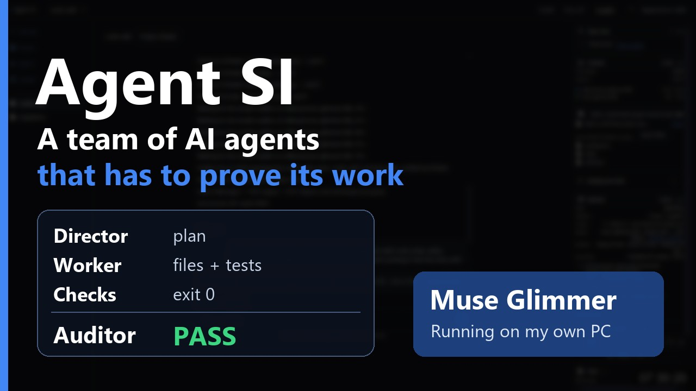
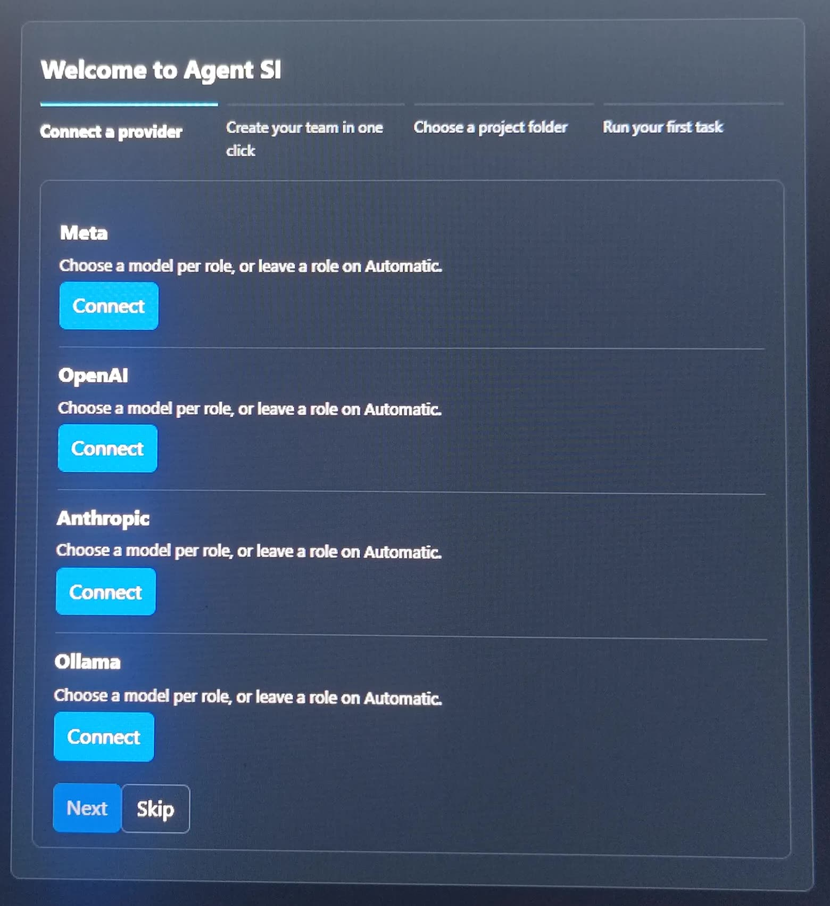
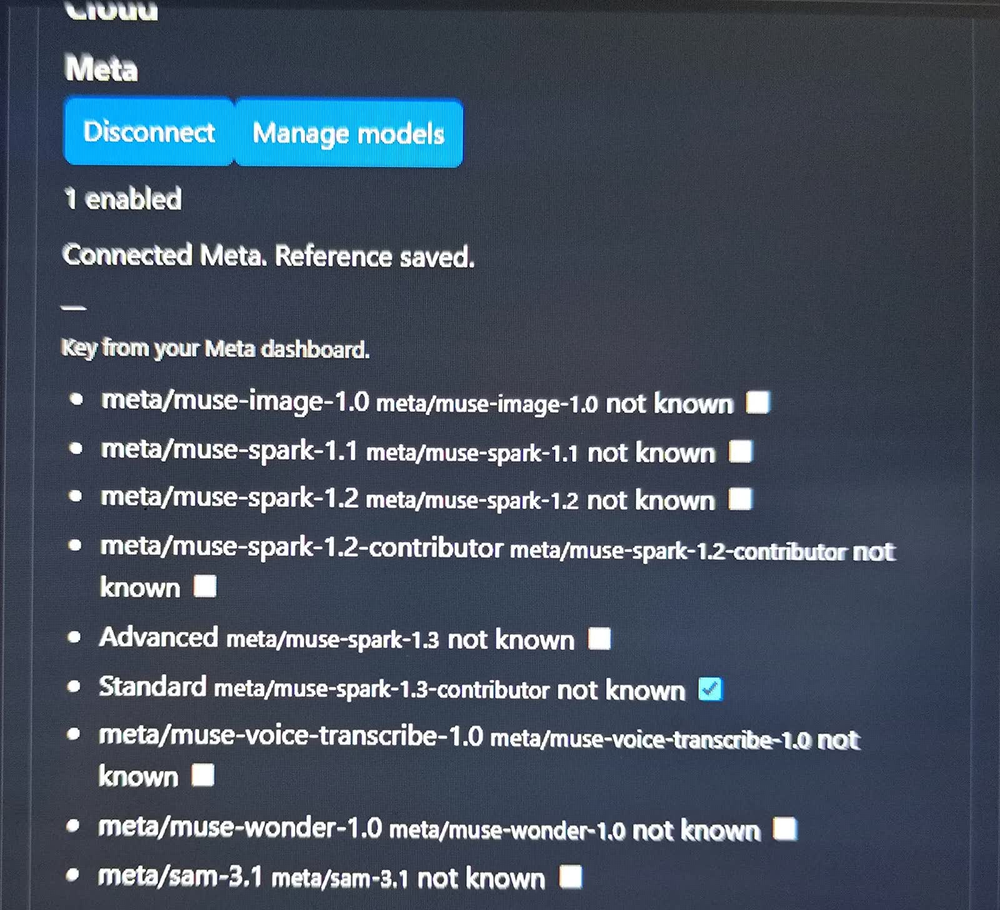
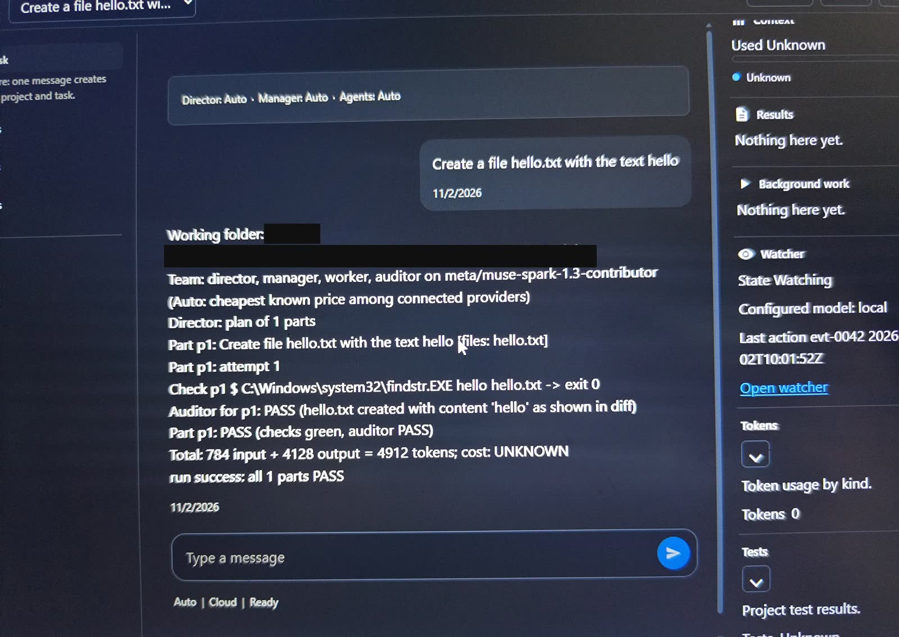

# Agent SI


Agent SI is a desktop app that takes one task in plain words and returns a checked result with evidence.
You describe the goal; the app plans the work with a team of model agents, runs the checks, and a fresh auditor gives the verdict.
Every run, decision and audit record stays with the project in a local data folder.
After the first start you connect a model in Settings -> Models. The proof of how it was built is in `docs/HOW_IT_WAS_BUILT.md`; the screenshots with captions are in `docs/EVIDENCE.md`. It ships under the MIT licence, see `LICENSE`.

[](https://youtu.be/Mf_OHejanns)

**[Download installer](https://github.com/kot0070/agent-si/releases/download/v0.1.0/AgentSI-setup-0.1.0.exe)** | **[Download zip](https://github.com/kot0070/agent-si/releases/download/v0.1.0/AgentSI-portable-0.1.0.zip)** | **[Watch the demo](https://youtu.be/Mf_OHejanns)** | **[Known issues](docs/KNOWN_ISSUES.md)**

Release page and hashes: https://github.com/kot0070/agent-si/releases/tag/v0.1.0 (steps to check the hash are under "Download and verify" below).

**Read more:** [The story of the build](docs/THE_STORY.md) | [Muse Code stress test](docs/MUSE_CODE_STRESS_TEST.md) | [How this was built](docs/HOW_IT_WAS_BUILT.md) | [Controlling about 100 agents](docs/CONTROLLING_MANY_AGENTS.md) | [Evidence files](docs/evidence/README.md) | [User guide](docs/USER_GUIDE.md) | [All documentation](#all-documentation)

### Prior work and where new work starts

Before the kickoff on October 26, I prepared the master plan, the feature list, the idea and the development strategy. I had no code for this project before the kickoff and copied none: the code started from zero after the kickoff, and the first commit in this repository is from October 26, 12:15 PM Texas time. The rest is experience from my other projects.

### After submission

- **Submitted:** November 4, 2026, about 3:15 PM Texas time (CST, UTC-6). The deadline was 8 PM Texas time (9 PM ET).
- **Last documentation update:** November 4, 2026, about 7:10 PM Texas time.
- **Why the documents grew:** the facts and details of the build come from the session archives that survived the delete incident, from my own messages, and from a full test run. Code changes: 0.
- **The app did not change after submission.** No later commit touches `src/`, `frontend/` or `packaging/`. The release files were published at 3:08 PM from commit `57295e8` and stay as they were.
- **What was added:** evidence files and photos of the first passes, the page on controlling about 100 agents with the real build scripts (copied for reading, not part of the app), the requirement list, the video scene by scene, the last two days of the build, the exact record of the delete incident, the story of the build, speed numbers for both Meta models, session and agent counts, a full test report, real hashes in the release notes, and a fuller list of known issues. The old draft folder was removed, and two tests were updated so they no longer need it.

Every change is in the [commit history](https://github.com/kot0070/agent-si/commits/main).

### What you need

- The app: the installer or the zip (Windows 10 or 11, 64-bit; no Python needed).
- A model: a Meta Model API key, or Ollama with `muse-glimmer:30b` on your PC.
- Speed: the same small task took 204 s on Muse Spark 1.3 through the API and 9 to 24 minutes on Muse Glimmer on my PC, which has 8 GB of video memory. The demo runs locally only because my bank blocked the Meta Model API billing on November 2: [speed numbers](docs/evidence/speed-spark-vs-glimmer.md).
- Without either you can open the app and its screens only; it cannot run a task.

### What it looks like

| First start | Meta models | A finished run |
|---|---|---|
|  |  |  |
| The guided first run, nothing connected yet. | The Meta model list, one model ticked. | Photo of a screen, Nov 2, 2026: a run on Muse Spark ends with "checks green, auditor PASS". |

More captions and photos: [docs/EVIDENCE.md](docs/EVIDENCE.md).

### What it does

The demo video goes through 14 main functions, some as live runs and some as their screens: [the video scene by scene](docs/evidence/final-film-scenes.md). The app does more. These are the 14, with the F numbers used in the test and evidence files:

| | Function |
|---|---|
| F01 | Code tests: a test catalog runs local code first, then AI checks, then a human verdict, with one switch per project. |
| F02 | Fixed team: every role is pinned to a model you choose, and the model of each level is recorded. |
| F03 | Auto team: picks the cheapest connected model that fits and records why. |
| F04 | Autonomous development: one task becomes a plan, parallel Managers, real checks and an audit. |
| F05 | Team control panel: role, model, step, file, cost and tokens for each agent. |
| F06 | Watcher: independent from the team, runs on scripts and calls a local or cloud model on an abnormal event. |
| F07 | Emergency Stop: one click stops everything, tested on an endless command. |
| F08 | Provider catalog: connect a provider with the key only. |
| F09 | Model knowledge base, with an Update action. |
| F10 | Local AI benchmark: measures local models on your own PC. |
| F11 | Knowledge bases: attach one to a project, or detach it. |
| F12 | Budget and per-provider caps. |
| F13 | Install permission: the app asks once before a command installs something. |
| F14 | Clean install: a fresh profile starts clean. |

Also in the app (every screen is described in the [user guide](docs/USER_GUIDE.md)):

- **Chat and projects:** chat as the home screen with Team on or off; projects with a folder, pause, resume and archive.
- **Project pages:** tasks, runs, time, AI usage, tokens, cost, local LLM, cloud AI, models, routing decisions, audits, errors, reports and tests.
- **Automations:** rules on a schedule, a number or an event, with templates, a preview and two stop switches.
- **Watcher controls:** Hang, Guard and Tamper rule cards, presets, alerts, timers, an integrity check, a list of apps and services, and on or off per project.
- **Routing:** role pools, role profiles, a setup wizard, a chat-model picker, and weights for cost, speed, quality and risk.
- **Local servers:** Ollama, LM Studio or any OpenAI-compatible server; Use for agents pins the team roles to one local model.
- **Model knowledge updates:** from the shipped copy, the official docs or a file, with old and new values side by side and Apply or Reject.
- **Test catalog screen:** versions, filters, changelog, and import or attach a base.
- **Everyday:** a guided first run, English and Ukrainian, dark and light themes, diagnostics, migration of older data, and live cards for team, context, results, background work and watcher.

The full list from the original build plan, 437 requirement rows: [docs/REQUIREMENTS_LIST.md](docs/REQUIREMENTS_LIST.md). What is still open: [docs/KNOWN_ISSUES.md](docs/KNOWN_ISSUES.md).

### What makes it different

- **A fresh auditor gives the verdict, not the agent that wrote the code.** In the demo run the app ran the checks itself (all exit 0) and the auditor said PASS: [docs/evidence/video-run-timing.md](docs/evidence/video-run-timing.md).
- **It can run fully on a local Meta model.** With every role on Muse Glimmer, the app talked only to this PC (no address outside loopback, no new DNS names): [docs/evidence/network-proof.md](docs/evidence/network-proof.md).
- **Keys and records stay on your machine.** Keys live only in the Windows Credential Manager; runs, decisions and audits stay in a local data folder: [docs/SECURITY.md](docs/SECURITY.md).
- **It shows "not known" instead of a made-up number.** The Tokens tab prints what it knows per role and model and says so when it does not: [docs/EVIDENCE.md](docs/EVIDENCE.md).
- **It was built with about a hundred agents, steered from one board.** The owner board shows every lane, how old its newest file is, silent agents, queue, scripts and gates on one screen: [docs/CONTROLLING_MANY_AGENTS.md](docs/CONTROLLING_MANY_AGENTS.md) and [tools/build_ops/owner_board.py](tools/build_ops/owner_board.py).

### All documentation

| Page | What is in it |
|---|---|
| [The story of the build](docs/THE_STORY.md) | Ten days told from start to finish: 101 agents on the first day, the wall, the deleted drive, the blocked card, the local model, Submit. |
| [Muse Code stress test](docs/MUSE_CODE_STRESS_TEST.md) | What broke with many agents at once, the measurements, the fixes, and what I would ask the Muse Code team. |
| [How this was built](docs/HOW_IT_WAS_BUILT.md) | The whole story: time, scale, team, custom tools, decisions, what went wrong, notes from the supervising AI, the last two days. |
| [Controlling about 100 agents](docs/CONTROLLING_MANY_AGENTS.md) | How one person kept control: the owner board with photos, rules, limits, watchers and the merge train. |
| [Build tools](tools/build_ops/README.md) | The real scripts from the build: owner board, merge train, gates, backup and delete alarm. |
| [Evidence files](docs/evidence/README.md) | Proof from real runs: demo timing, network check, Team On and Off results, clean install, release hashes, gate summary. |
| [Screenshots and photos](docs/EVIDENCE.md) | Pictures with captions, including the first passes on Muse Spark. |
| [Requirements list](docs/REQUIREMENTS_LIST.md) | The 437 requirement rows from the original build plan. |
| [Meta models and contributions](HACKATHON_CONTRIBUTIONS.md) | Which Meta model each role used, and what is new in this project. |
| [Model eval](docs/MODEL_EVAL.md) | How the reasoning level for each role was measured and chosen. |
| [User guide](docs/USER_GUIDE.md) | Every screen of the app in plain words. |
| [Troubleshooting](docs/TROUBLESHOOTING.md) | Common problems and what to do. |
| [Architecture](docs/ARCHITECTURE.md) | How the app is put together. |
| [Security](docs/SECURITY.md) | Keys, local data and what the app protects. |
| [Known issues](docs/KNOWN_ISSUES.md) | What is still open, and what was checked on the release code. |
| [Release notes](docs/release/RELEASE_NOTES.md) | Files of this release, hashes and how to verify them. |
| [Package reports](docs/reports/README.md) | One report per work package, K01 to K13, written during the build. |
| [Earlier stress report](docs/MUSE_STRESS_STORY.md) | The first field report on the stress test. |

### Where things are

| Folder or name | In plain words |
|---|---|
| `src/agent_si/` | The app's Python code: the local service, the team of agents, providers, routing, budget, watcher, knowledge bases. |
| `frontend/` | The web interface shown in the app window. Its tests sit in `__tests__` folders. |
| `tests/` | The Python tests. |
| `packaging/` | Builds the installer and the portable zip. |
| `iface/` | Interface files frozen by hash, with the contract tests that hold the code to them. |
| `tools/` | Development tools: a knowledge-base validator, a demo drive, and `tools/build_ops/` (the board, merge train, gates, watchers). Not part of the app. |
| `docs/` | Guides, evidence, screenshots, the build story and the known issues. `docs/evidence/` holds the sanitized proof files. |
| `docs/reports/` | One report per work package (K01 to K13). |
| `licenses/`, `LICENSE` | The MIT licence. |
| K01 | Day 0: contracts and who owns which module. |
| K02 | Hierarchy and orchestration: Director, Managers, workers. |
| K03 | Assurance, the QA catalog and the test stage: the fresh auditor and the checks. |
| K04 | Providers, routing, model knowledge and the budget. |
| K05 | Local AI (Ollama and other local servers). |
| K06 | The tool belt, permissions and services. |
| K07 | The shell, UX, cards and languages. |
| K08 | The watcher, automations and context. |
| K09 | Knowledge bases. |
| K10 | The installer, proofs and acceptance. |
| K11 | Follow-up, plan only. |
| K12 | Presentation and demo. |
| K13 | The run core: contracts and state machines. |

Meaning of K01 to K13 comes from the module ownership map in [docs/reports/K01.md](docs/reports/K01.md).

## Quick start (Windows, from source)

This checkout runs the whole app. You need: Windows 10 or 11, 64-bit; Python 3.13 or newer (the
`requires-python` floor in `pyproject.toml`); Node.js with npm (the web UI build scripts in
`frontend/package.json`); and the Microsoft Edge WebView2 runtime for the native window (without it the
app opens in your default browser instead).

In PowerShell, in the checkout root:

```powershell
py -3.13 -m venv .venv
.\.venv\Scripts\python.exe -m pip install -e .
npm.cmd --prefix frontend install
npm.cmd --prefix frontend run build
$env:AGENT_SI_DATA_DIR = "$PWD\data"
.\.venv\Scripts\python.exe -m agent_si.sidecar
```

Each step is checked against this repo:

- `npm.cmd` instead of `npm`: in Windows PowerShell with the default execution policy, `npm` resolves to
  `npm.ps1`, which the policy refuses ("running scripts is disabled on this system"); `npm.cmd` is the same
  npm and runs. (In `cmd.exe` plain `npm` works too.)
- `npm.cmd --prefix frontend run build` is the `build` script of `frontend/package.json`; it writes the web
  UI to `frontend/dist`, which the sidecar serves. Without that build the window answers
  "Agent SI web UI is not staged: the web tree holds no index.html".
- `uvicorn` is a declared dependency in `pyproject.toml` (`src/agent_si/sidecar.py` imports it when it starts), so
  `pip install -e .` installs it; no separate install is needed.
- `AGENT_SI_DATA_DIR` is the data folder. A source checkout has no default data folder (only the
  packaged exe falls back to a `data` folder beside itself), and a blank value fails loudly instead of
  falling back silently.
- Start the app with `python -m agent_si.sidecar` or with the `agent-si` console script: after `pip install -e .`
  the script points at the same sidecar entry (`agent_si.sidecar:main`) and starts the app and its window.

The app serves on loopback (`http://127.0.0.1:<port>/`) and opens its window, or your default browser
when no window is available. Closing the window stops the app. On a fresh profile the first screen is
the guided first run at `/firstrun`.

Optional checks, also from this repo:

```powershell
npm.cmd --prefix frontend run check
npm.cmd --prefix frontend test
```

The backend suite runs with pytest (settings in `pytest.ini`, including the 120 s per-test timeout).
pytest is not among the runtime dependencies in `pyproject.toml`, so install it in the same venv first:

```powershell
.\.venv\Scripts\python.exe -m pip install pytest pytest-timeout
.\.venv\Scripts\python.exe -m pytest
```

This runs every test in one process, including older test files in subfolders of `tests/`. On November 4 it gave 4,416 passed and 50 reds. None of the 50 is a confirmed defect in the app: 9 are outdated tests, 2 are not proven either way, and 39 come from running all tests in one process and pass when their file runs alone. Each one is listed in [the full test run](docs/evidence/full-test-run.md).

## Two ways to run a model

The app does the work with a model you connect. There are two real options; either one is enough.

### Option A: hosted Meta API key (Muse Spark)

1. Open Settings -> Models and press Connect on the Meta row.
2. Paste your Meta API key (the dialog hint reads "Key from your Meta dashboard."), press Check, then
   Save. Only a checked key is stored; a refused key stores nothing and keeps the old working key.
3. This build's Meta catalogue holds `meta/muse-spark-1.3-contributor`, with a 1,048,576-token context
   window in the shipped model knowledge base. Only ticked models reach Auto, the role pools and the
   chat picker.

### Option B: fully local with Ollama and Meta's open model Muse Glimmer

1. Install Ollama for Windows from ollama.com (an outside download; nothing in this repo installs it).
2. Pull the model in PowerShell:

   ```powershell
   ollama pull muse-glimmer:30b
   ```

3. Start the app and open Settings -> Local LLM. The Ollama row shows `http://localhost:11434`; press
   Connect there. Local rows need no key ("Local server: usually no key is needed."); once connected
   the row reads "Connected Ollama, N models."
4. Pick `muse-glimmer:30b` under Local models and press Use for agents: the app pins the Director, Manager,
   Worker and Auditor roles to that model through the same role-pool route the role editor uses, then reads
   the four roles back and lists each one on the model. Routing, checks and audit work exactly as with a
   cloud model. The Watcher is a fifth role: pin it in the role editor too (Settings -> Roles) if you want
   the Watcher on Glimmer; unpinned, it stays on its rules only.
5. Disk need: about 18 GB of free space for the 30B model. On 8 GB of video memory it runs split with
   the CPU and is slow (measured on an RTX 3070 8 GB + 32 GB RAM: about 2.6 tokens per second). The
   small Node task "node-add", measured on my PC, took 24 min with Team On (Director, Worker, Auditor) and 18 min with Team
   Off on that PC; a smaller local model or the hosted key is the fast path. Local model calls wait up to
   60 minutes each; slow is not stuck.
   Last test of this build, measured on my PC: the node-add task ran 2 times in a row (Team On, muse-glimmer:30b, fresh data each
   time, same PC): 2 of 2 passed, in 11.2 and 8.6 minutes.

### Which Meta model runs each role

| Role | Setup 1: Muse Spark through the Meta Model API | Setup 2: Muse Glimmer locally through Ollama |
|---|---|---|
| Director | `meta/muse-spark-1.3-contributor`, hosted by Meta (needs your Meta API key) | `muse-glimmer:30b`, on this PC (Ollama, `http://localhost:11434`) |
| Manager | `meta/muse-spark-1.3-contributor`, hosted by Meta | `muse-glimmer:30b`, on this PC |
| Worker | `meta/muse-spark-1.3-contributor`, hosted by Meta | `muse-glimmer:30b`, on this PC |
| Auditor | `meta/muse-spark-1.3-contributor`, hosted by Meta | `muse-glimmer:30b`, on this PC |
| Watcher | Rules only by default; pinned on the Watcher role, a hosted Meta model (Muse Spark) answers only when the project's Watcher cloud fallback is on (`src/agent_si/watcher/rules.py`) | `muse-glimmer:30b`, on this PC, when the Watcher role is pinned to it (Settings -> Roles); the Watcher card then shows the model name, its model calls and tokens |

This demo calls only Meta models at runtime: Muse Spark through the Meta Model API and Muse Glimmer through
local Ollama. Adapters for other providers exist in the code as an option; this demo does not call them.
A role left on AUTO picks from the models you connected, so connect only the Meta model you want used.

The same Local LLM page also lists LM Studio (`http://localhost:1234/v1`), and Settings -> Models can
connect any OpenAI-compatible server: that dialog asks for the server's Base URL.

## Requirements

- Windows 10 or 11, 64-bit.
- WebView2 runtime. If it is missing, the app shows a message with the download link and also opens the app in the default browser.
- No Python install needed to run the app. Code tests on Python projects need a real Python: install Python (so `python` runs) or set `AGENT_SI_PYTHON` to a python executable. On Windows, a `python` that only opens the Microsoft Store never counts: the app skips that stub and tries the `py` launcher instead. No administrator rights needed. The portable build runs from its own folder.
- The bundle carries the licence text and the third-party notices; both are also shown on the About screen.

## Download and verify

Releases are published at https://github.com/kot0070/agent-si/releases/tag/v0.1.0.
Each release publishes an installer (`AgentSI-setup-0.1.0.exe`), a portable
zip (`AgentSI-portable-0.1.0.zip`), and a `SHA256SUMS.txt` index (one
`<sha256>  <filename>` line per file). Download the index together with
whichever package you use, and do not run anything if a hash differs.

### Installer (recommended)

1. Download `AgentSI-setup-0.1.0.exe` and `SHA256SUMS.txt`.
2. Check the hash in PowerShell:

```powershell
Get-FileHash -Algorithm SHA256 AgentSI-setup-0.1.0.exe
```

3. Compare the value with the `AgentSI-setup-0.1.0.exe` line in
`SHA256SUMS.txt`.
4. Double-click the installer and follow the wizard. It installs per user
(no administrator rights needed), adds a Start-menu entry and a desktop
shortcut (both named 'Agent SI', both checked by default in the wizard,
opening AgentSI.exe in its folder), and can start the app at the end.
Uninstalling removes both shortcuts and keeps your data
folder unless you answer Yes to deleting it (see Remove below).

The build is unsigned, so Windows SmartScreen shows "Windows protected your PC" with publisher Unknown for the installer and again on first start.
This is expected for this release.
Click More info, then Run anyway - only after the SHA256 value matches the published SHA256SUMS.txt.
Do not run the app if it differs.

### Portable

1. Download `AgentSI-portable-0.1.0.zip` and `SHA256SUMS.txt`.
2. Check the hash in PowerShell:

```powershell
Get-FileHash -Algorithm SHA256 AgentSI-portable-0.1.0.zip
```

3. Compare the value with the `AgentSI-portable-0.1.0.zip` line in
`SHA256SUMS.txt`. The zip holds one top folder `AgentSI/` and carries its
own `SHA256SUMS.txt` inside, with the hash of every file including
`AgentSI.exe` at the top folder root.
4. If the zip was downloaded, unblock it before unzipping: right-click the zip -> Properties -> check Unblock -> OK (or PowerShell: Unblock-File -LiteralPath .\AgentSI-portable-0.1.0.zip).
5. Unpack the zip into an empty folder, open the `AgentSI` folder inside it,
and run AgentSI.exe inside it by double-click (or run `Start-AgentSI.cmd`
beside it). Never copy the exe out of its folder: it needs its support
files beside it.

The same SmartScreen warning as above appears on first start (unsigned
build, publisher Unknown): More info, then Run anyway - only after the
hashes match.

## First run, step by step

The app opens a first-run guide with four steps. The guide reads its state from the server, never from local guesses. A step counts as done only when the server confirms it.

1. Connect a provider. The guide shows the provider rows and a Connect button for each. The Next button stays disabled until the server reports at least one connected provider. A Skip control moves on without connecting: the guide still finishes, but the chat waits for a provider (it shows "No model bound yet." with a link to Settings -> Models, and the status reads Blocked until you connect).
2. Create your team in one click. Enter a team name and save. The app creates or reuses a project and saves Automatic for every role. Next moves on with or without saving.
3. Choose a project folder. Enter a folder value, optionally use Choose folder to pick it with the system dialog, then Create. The app creates the project through the real project service.
4. Run your first task. Enter a task title and Create. The app creates the task through the real task service and shows the created task. The Continue control finishes the guide and opens the chat with the task title ready.

The last step also shows an optional quiet list: Local LLM, Watcher preset, Automations, and Knowledge bases. Each can be skipped.

To open the guide again, go to `/firstrun`.

## Connect a provider

Go to Settings -> Models, or use the Setup wizard on the first-run screen.

1. Pick a provider row and choose Connect.
2. Enter the key in the password field and save.
3. The row shows the connected state. Disconnect removes the connection.

Search filters the list by provider or model name. Model checkboxes are enabled only when the provider is connected. An optional setup wizard, role pools, and a chat-model picker are on the same page.

The connect dialog shows the expected key format, and a key that does not fit shows "This key does not match the expected format." before you save (a warning only). Connecting itself is three steps: paste the key, press Check, then Save. Check tries the key against the live provider without storing anything: a good key answers "Key checked. Save to connect." and enables Save (local providers check at once, with no network). A wrong key answers "The provider refused this key. Paste the full key again." and nothing is stored — a failed replace keeps the old working key; an unreachable provider answers "The provider is slow or unreachable. Your key is saved. Press Connect again.". Save stores the checked key (the server checks once more first) and only then reports "Connected {label}."; the local reference copy is written only after the server answers.

Model checkboxes switch models on and off for the team: only ticked models reach Auto, the role pools, and the chat picker. A fresh connect ticks only the default model. On the project Models route a team quick-fix card can apply the routing's suggested binding (Accept) or drop it (Dismiss).

Supported providers include hosted Meta (Muse Spark 1.3), OpenAI, Anthropic, and local servers for
local models (Ollama, LM Studio, any OpenAI-compatible server).

## Keys: Windows credential store only

Provider keys are stored only in the Windows Credential Manager under the app namespace. The app never writes a key to a plain file, never shows it again, and never logs it. The settings and the browser storage hold only references, never key material. Disconnect deletes the stored entry.

## Where data lives

- Project data (projects, tasks, runs, decisions, audits, watcher journal, knowledge-base links) lives in the app data folder. The portable default is the `data` folder next to `AgentSI.exe`. If that folder is not writable, the app uses the per-user app data folder. Setting the `AGENT_SI_DATA_DIR` folder path overrides both. An empty value fails loudly instead of silently falling back.
- On first start the app copies previous settings and keys into the new data folder and keeps the originals untouched. A file that already exists at the destination is never overwritten.
- Interface preferences (first-run done flag, language, watcher display options) live in the browser local storage. Tab-only mirrors (role profiles, accepted risk) live in the session storage. Key material never lives there.
- Secret references live only in memory while the app runs.

## Remove and closing

- Remove: delete the app folder. Data lives in the `data` folder next to `AgentSI.exe` by default (`%LOCALAPPDATA%\AgentSI\data` when the app folder is not writable; the `AGENT_SI_DATA_DIR` folder path overrides both). Delete that data folder too for a full removal. Installed: Windows Settings -> Apps -> Agent SI -> Uninstall; the uninstaller keeps your data folder unless you answer Yes to deleting it. Provider keys live in the Windows Credential Manager under `app:<provider>` — Disconnect removes the entry.
- Closing is safe: history and records stay on disk and reappear on the next start. Closing the window ends the backend, so an active run stops with it.
- One copy at a time: starting the app again focuses the first window instead of starting a second copy.

## First task and Stop

1. Create or open a project.
2. Type the task in the chat box and send. With no project, sending creates a project named from the start of the message and then creates the task.
3. Watch progress in the chat, the team panel, and the Tests tab.
4. The result appears in the chat with its checks and the audit verdict. Reports and the evidence index stay with the project.

Stop: the top bar has Stop all. One click, with no confirmation dialog, stops the active runs at once and keeps partial outputs and records.

## Known limits

- Unsigned build: SmartScreen warns. Verify hashes first.
- WebView2 is required for the desktop window. Without it the app shows the download notice and falls back to the browser.
- The folder picker needs a native window. Where no native dialog exists, the Choose control hides itself instead of failing.
- Local models need a running local server on the loopback address: Ollama at localhost:11434, LM Studio at localhost:1234/v1, and any OpenAI-compatible server at the Base URL you give it. Settings -> Local LLM says "Local server is not running. Start Ollama first, then Check again." when nothing answers, and local checks elsewhere report not configured.
- Budget starts at USD 5.00 per project with a soft limit of 4.00 and a hard limit of 5.00. When the budget is exhausted, new work is blocked with a plain message.
- Some screens show empty or unknown states until the server has records. The app never invents numbers.

## Licence

Agent SI ships under the MIT licence. Copyright (c) 2026 Ivan Soprun. See `LICENSE` at the checkout root. Third-party titles and licences are listed in `docs/third_party_notices/NOTICES.md` and shown on the About screen.

## How this was built

Owner-observed: over 100 agents at once. In the surviving records (id-clock recount): 101 Muse live at 10-26 19:49 (104 combined), 66 active at 10-26 23:37; working-min averages 33.83 live / 10.73 active. Field report: [docs/MUSE_STRESS_STORY.md](docs/MUSE_STRESS_STORY.md).

One person set the goal and the rules; Claude Code steered, with Muse through
the API in support: they wrote tasks and accepted work; Muse Code directors split them across parallel lanes that
merged serially through a gated landing loop. Every change needed a fresh auditor, a real run with quoted output,
and a row-by-row reality check before it shipped. Custom tooling enforced
it: a merge train, prove-they-ran gates, a destructive-command guard, live
UI/exe drives, and a defect ledger.

After the Meta Model API billing was blocked on November 2, Claude workers through OpenCode did the last two days of coding, tests and docs. The app itself still calls only Meta models in the demo: every role runs on Muse Glimmer. Details: [the last two days](docs/HOW_IT_WAS_BUILT.md#10-the-last-two-days-november-3-and-4).

- Full story: [docs/HOW_IT_WAS_BUILT.md](docs/HOW_IT_WAS_BUILT.md)
- Stress page (what broke, what we built): [docs/MUSE_CODE_STRESS_TEST.md](docs/MUSE_CODE_STRESS_TEST.md)
- Screenshots with captions: [docs/EVIDENCE.md](docs/EVIDENCE.md)

The per-role reasoning level was picked by a small measured eval, not by guessing: see [docs/MODEL_EVAL.md](docs/MODEL_EVAL.md).

Current open issues: [docs/KNOWN_ISSUES.md](docs/KNOWN_ISSUES.md).

## Development notes

- Muse Code stress test: what broke at high concurrency, the fixes, and what we would ask the Muse Code team: [docs/MUSE_CODE_STRESS_TEST.md](docs/MUSE_CODE_STRESS_TEST.md).
- How one person controlled this many agents, with the owner board and photos: [docs/CONTROLLING_MANY_AGENTS.md](docs/CONTROLLING_MANY_AGENTS.md).
- Build operations tools, shown as written (not part of the app): [tools/build_ops/README.md](tools/build_ops/README.md).
- Evidence files (timing, network proof, clean install, release hashes, gate summary): [docs/evidence/README.md](docs/evidence/README.md).
- Screenshots and photos with captions: [docs/EVIDENCE.md](docs/EVIDENCE.md).
- How the project uses Meta's models: [HACKATHON_CONTRIBUTIONS.md](HACKATHON_CONTRIBUTIONS.md).
- The full requirement list from the original build plan: [docs/REQUIREMENTS_LIST.md](docs/REQUIREMENTS_LIST.md).
- Earlier field report on the stress test: [docs/MUSE_STRESS_STORY.md](docs/MUSE_STRESS_STORY.md).
- Known issues: [docs/KNOWN_ISSUES.md](docs/KNOWN_ISSUES.md).
