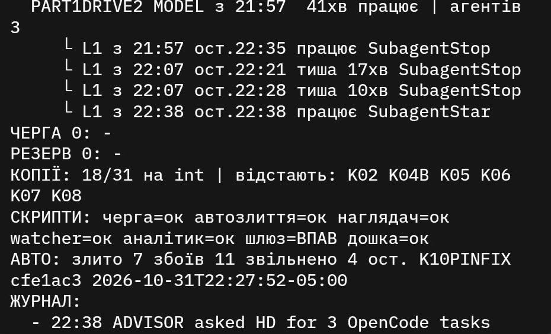
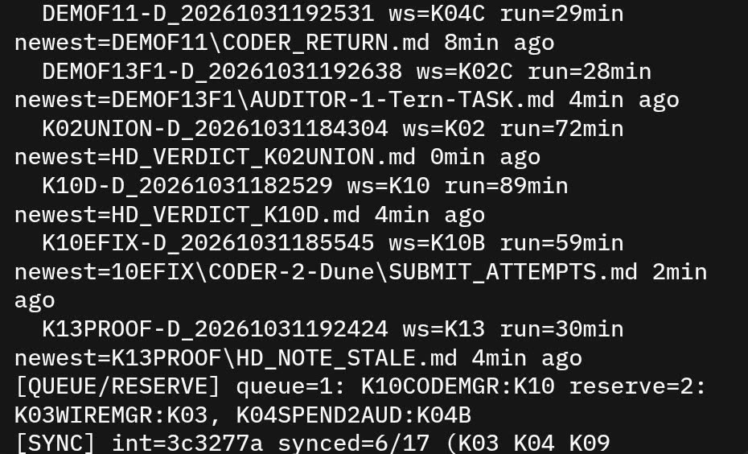
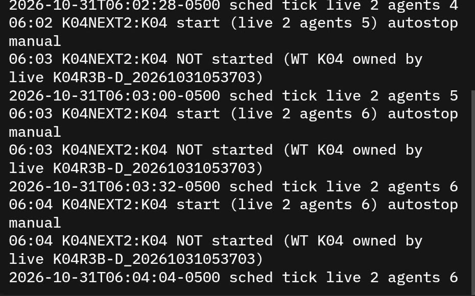

# How one person controlled this many agents

I built Agent SI with many agents running at the same time. During those days I felt like the head of a big company with about a hundred staff, and it was stressful. At the measured peak, 101 Muse agents were live at once ([stress page](MUSE_CODE_STRESS_TEST.md)). This page is how I kept that under control, what held, and what failed. The numbers come from [How this was built](HOW_IT_WAS_BUILT.md) and the [stress page](MUSE_CODE_STRESS_TEST.md); I added none.

## 1. The owner board: one screen for all agents

For controlling many agents, this board is a must-have. For me it was the only workable way to track them. Logs and chat did not scale past a few agents. One text screen on my phone did.

The script is [owner_board.py](../tools/build_ops/owner_board.py) (with [lane_status.py](../tools/build_ops/lane_status.py), which it shares). It is read-only and uses only the standard library. It reads the build's own files and never writes product work.

### What one screen shows

- **Each lane**, with its stage (working, in audit, passed and waiting to merge, conflict, failed at the coder) and how many minutes it has been idle.
- **How long each run has been going**, and its **newest artifact with the artifact's age**: the last file the run wrote, and how many minutes ago.
- **Silent agents**: each sub-agent of a run, with when it started, its last event, and "working" or "silent N min".
- **Queue and reserve**: what waits to start, and the ready briefs held back to refill a free slot.
- **Worktrees on int**: how many package copies already contain the integration branch, and which ones lag behind.
- **Health of each script**: queue, auto-merge, watcher, analyst, gateway, board, merge train, gate, backup. Each reads "ok" or "down".
- **Auto-merge counts**: merged, failed, freed, and the last lane it touched.
- **The newest gate verdict**, and whether it was run on the current int.
- **The journal**: a few lines of what happened. The Nov 2 version also adds the raw log tails with times.

A value the board cannot read prints "нема даних" (no data). It never guesses and never crashes.

### Why artifact age tells whether an agent really works

A process list says a run is alive. It does not say the run is working. A run that waits on a dead child, on a lock, or on nothing still shows as running. But a working agent writes files: returns, notes, verdicts, attempts. When the newest file under a run's task folder gets old, the run is not working, whatever its status says. The board version in the first photo below flags a run as silent when its newest file is older than 10 minutes (`SILENT_MIN = 10` in the script). The later version reads the lane's last activity instead and marks a lane as stalled ("СТОЇТЬ") after 8 idle minutes (`STALE_MIN = 8`), unless an audit started recently.

This is not a theory. In the measured incidents on the stress page, a manager polled a coder that had been dead for about 50 minutes while its siblings kept writing, so the tree looked busy. Four status files said "running" with both process IDs gone, and they held the scheduler at its cap. Process state lied. File age did not. The same rule is used when freeing lanes: never stop a run whose newest artifact is younger than 10 minutes.

### Photos

Both are photos of my phone, cropped to the dark terminal panel. The board is in Ukrainian because I read it in my own language; the legend below translates it.



*October 31, 22:39, photo of my phone.* One run, 41 minutes old, with 3 agents. Each sub-agent line gives the time it started, the time of its last event, and "working" or "silent N min": two lines read silent for 17 and 10 minutes, the others read working. Queue 0, reserve 0. "КОПІЇ: 18/31 на int": 18 of 31 package copies are on int; K02, K04B, K05, K06, K07 and K08 lag. Scripts: queue, auto-merge, watcher, analyst and board are ok; the gateway is down ("ВПАВ"). Auto-merge: 7 merged, 11 failures, 4 freed, last lane K10PINFIX.



*October 31, 19:55, photo of my phone.* Six runs are visible. Each line is a run, the package copy it works in, how long it has run, and its newest file with the age: for example a run of 29 minutes whose newest file is a coder return from 8 minutes ago, and a run of 72 minutes whose newest file is a verdict written 0 minutes ago. Then queue (1) and reserve (2), and the sync line: the int commit and "synced=6/17" copies.

These two photos are from October 31. The script later got a cleaner screen built from the merge-train files (head, merge, lanes, gate, people, scripts, build, journal, logs). That one is the version in this repository.

### A text sample of the current board

This is the real output of the script run on Nov 4 at 15:45 PC clock, after the build had stopped. It shows the point well: four lanes idle for more than 1,100 minutes are flagged as stalled, and the merge train and backup scripts are reported down because they are no longer running.

```text
============================================
! УВАГА:
  - merge_train ВПАВ (злиття стоїть)
AGENT SI 15:45 | int d0862bb | ЗЛИТО 73/77
ЗЛИТТЯ: FXAUTO 2391хв тому
ЛЕЙНИ 4:
  FXDESIGN  працює           1643хв СТОЇТЬ
  FXDENYLINE працює           2390хв СТОЇТЬ
  FXFACTS   працює           1643хв СТОЇТЬ
  FXROLEPICK працює           1176хв СТОЇТЬ
ГЕЙТ: PASS d0862bb358f3 12хв тому (=int)
ЛЮДИ: HD2 2386хв сабів 207
СКРИПТИ: merge_train=ВПАВ int_gate=ок(26404) backup_15min=ВПАВ дошка=ок(33488)
ЗБІРКА: ABSENT (no portable HASH.json)
ЖУРНАЛ:
  - GATE FAIL 9ceceec87b40 1/10
  - GATE PASS f647f9591297 0/6
  - GATE PASS 9282aa277ec9 0/6
  - GATE PASS 03e905f71983 0/6
  - GATE PASS 57295e863393 0/6
  - GATE PASS d0862bb358f3 0/6
```

Legend: ЗЛИТТЯ = merge (last lane landed, minutes ago); ЛЕЙНИ = lanes not yet merged, with stage and idle minutes; ГЕЙТ = newest gate; ЛЮДИ = people (my session's idle minutes and its sub-agent count); СКРИПТИ = script health; ЗБІРКА = the exe build; ЖУРНАЛ = journal; ВПАВ = down; ок = ok; СТОЇТЬ = stalled; хв = min; тому = ago; працює = working.

### How to run it

```text
python owner_board.py            one screen, printed once (--once is the default)
python owner_board.py --loop 30  rewrite one output file every 30 seconds; read that file on a phone
```

The script finds the build root from its own location and reads the build's folders, so it works only inside that layout. In this repository it is here to read. The copies carry placeholders, see [tools/build_ops/README.md](../tools/build_ops/README.md).

## 2. The hierarchy

One person (me) set the goal and the rules and took every product decision. A steering role, mainly Claude Code sessions with Muse in support, wrote short tasks and accepted work. Muse Code directors split work into the maximum number of non-conflicting managers, and managers into coder agents. Separate OpenCode sessions ran tools, checks and counts. The author never audits its own work: every link ends with a fresh auditor.

## 3. Rules that held

- No PASS without a real run: the command and a quoted tail. A signatures-only check is never PASS.
- A fresh auditor per link; the author never checks itself.
- Every task carries an entry-to-result check that the auditor runs again.
- A row-by-row reality check per coverage row before a package counts as built: REAL, FAKE, MISSING or WAITS-LIVE, with FAKE 0 and MISSING 0.
- Interfaces are frozen by hash. A change is re-frozen with notes to all lanes.
- One writer to the shared branch; everything else proposes.
- No agent deletes anything.
- Cap the work in flight, and measure the cap.

First-pass acceptance across the build was 43.7 %, with 262 tooling rejects ([How this was built](HOW_IT_WAS_BUILT.md#2-scale)). The rules cost time. They are why the result can be checked.

## 4. Measured limits

- **Run cap.** The sandbox lock errors depended on the number of concurrent runs. With 7 to 11 runs about 4 % of shell calls failed; with 12 to 19 runs about 30 % (a standing rule, not re-measured). A scan of 155 run folders gave failure shares of 35 to 53 % at 5 to 11 live runs and 2.8 % at 4. Details: [stress page, section 2](MUSE_CODE_STRESS_TEST.md).
- **Useful work stops growing early.** On 27 Oct I capped Muse runs at 5, product only, with starts at least 2 minutes apart, re-measured every 2 hours. More runs did not give more finished work.
- **Cost of a healthy lane.** 6.1 minutes and $0.031 (measured). The cost that hurt was stalled lanes, such as a run of 184 minutes against a cap of 75 + 30.

## 5. Watchers

- A **stuck ladder** over the runs: a silent flag at 20 and 40 minutes without task progress, one wake for me at 60, one note to the Director at 80, at most one per hour. It is in [muse_watch.py](../tools/build_ops/muse_watch.py).
- **PID-validated liveness** (process handle, exit code, creation time) after the stale "running" files held the scheduler.
- A **mass-delete alarm**, [wipe_watch.py](../tools/build_ops/wipe_watch.py), after the delete incident (section 8).
- A **spend guard**, [planb_spend.py](../tools/build_ops/planb_spend.py), with a stop below the cap.
- A scheduler that does not let two runs own one folder. This photo of the scheduler log shows it refusing three times to start a run because its work folder belonged to a live run:



*October 31, 06:04, photo of my phone.*

## 6. The merge train

Parallel lanes overwrote each other, so landing became one serial loop with one writer to the integration branch ([merge_train.py](../tools/build_ops/merge_train.py)). It keeps a lane table, writes its state atomically, runs a gate on each landing, and notifies once on a failure. It landed 43 lanes in order; its log covers 321 lines over 5 h 16 min, and its test suite passed 38 tests ([How this was built](HOW_IT_WAS_BUILT.md#7-numbers-each-with-its-source-command)).

## 7. Gates

"Green" merges once broke the tree, and some suites had not run at all. So a gate must prove it ran: the exact command, the counts, a negative control. [int_gate.py](../tools/build_ops/int_gate.py) runs after merges and before any build; [build_gate.py](../tools/build_ops/build_gate.py) checks the staged exe build. The gate on the last integration build, with what failed there, is in [docs/evidence/final-gate-summary.md](evidence/final-gate-summary.md). The evidence index is in [docs/evidence/README.md](evidence/README.md).

## 8. What failed

- **The delete incident.** One of my own agents, cleaning its scratch folder, ran a recursive delete over a drive glob built from character codes, so no filter on command text could have read it. Product and worktree trees were gone, on a disk with no undelete. I recovered from clones, the spec files and a replay of 406 sessions. Fixes: agents never delete, off-drive backups ([backup_15min.py](../tools/build_ops/backup_15min.py)), a command guard, and the alarm.
- **False greens.** Fixture-only rows passed while the real interpreter was missing from the path. Fix: real-binary probes and named test fixes instead of silent edits.
- **Tool hangs.** A backup died on a locked file, walk items hung without bound, and a test went over its timeout. Fix: skip lists, a per-item hang guard, per-test timeouts.
- **Dead and hung sessions.** A dead coder polled for about 50 minutes; stale "running" files; orphan console windows (43/60 to 62/91 in about 5 minutes). Details are on the [stress page](MUSE_CODE_STRESS_TEST.md).
- **Loop instances clobbering shared state.** Fix: a single-instance guard and atomic writes.
- **Backups themselves.** The 15-minute backup became a 2-hour one because the copies filled the backup disk.

## 9. Reusable lessons

- One writer to the shared branch; everything else proposes.
- Prove the check ran (counts, negative control, artifact), not just PASS.
- A filter on command text is not protection: keep off-drive backups and an alarm, and no agent deletes anything.
- A fresh auditor per link; the author never checks its own work.
- Cap the work in flight, and measure the cap; do not eyeball it.
- Watch files, not only processes: a process can be alive and idle.
