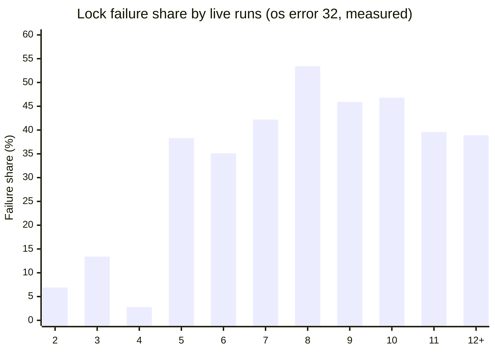

# Muse Code under stress: what broke, what I built, what I would ask

I built Agent SI with Muse Code agents, running several agent trees at the same time on one Windows machine. Peak load in my scans was 11 live runs at the agent peak (101 agents); some windows had 12 or more runs. This page is my field report for Meta engineers and hackathon judges. Muse carried most of this load. Most of the problems came from running many agents on one desktop, not from the model itself.

Every number below comes from a script that counted session logs. Each one is marked as **measured** or as a **standing rule**, and the one number I saw myself but could not count from files is marked **owner-observed**.

**Updated on November 4, after submission.** Added: the agent and session counts below, from the session archives and fresh sessions that survived the delete incident, the dead sessions I saw myself, and a note on that incident. No earlier number on this page changed, and no app code changed.

## At a glance

| Headline | Number | Type |
|---|---|---|
| Peak Muse agents live at once (floor, 26 Oct 19:49) | 101 (104 with OpenCode) | measured |
| Peak Muse agents actively working (26 Oct 23:37) | 66 | measured |
| Lock failure share with 5 to 11 live runs | 35 to 53 % of shell results | measured |
| Lock failure share with 4 live runs | 2.8 % | measured |
| Run folders scanned for the lock study | 155 (10-minute buckets) | measured |
| Experiment cost, 505 to 865 runs | $18.07 to $30.47 | measured |
| Healthy lane, end to end | 6.1 min, $0.031 | measured |
| Dead coder still polled while the tree looked busy | about 50 min | measured |
| Orphan console windows in one incident | 43/60 to 62/91 in about 5 min | measured |
| Distinct Muse agents in the surviving records, up to 1 Nov (floor) | 7,079 (1,617 roots, 5,462 subagents) | measured |
| Muse sessions in the surviving records, up to 1 Nov (upper bound) | 4,770 | measured |
| OpenCode sessions on this project, 27 Oct to 4 Nov, not all on Muse | 1,474 | measured |
| Open dead sessions seen in the app | on the order of 800 to 1,000 | owner-observed |

**What the counts mean.** A run is one launched agent tree with many agents inside it, so the run counts on this page do not show how much agent work there was. The working folders of 155 runs were lost in the delete incident, but the session archives from the first day survived, along with the fresh sessions not yet archived, and the agent counts come from them. Some records have no event file, so these numbers are floors unless marked otherwise.

**How 7,079 and 4,770 relate.** They are different units, and the second is not a separate total. 7,079 counts every agent id, roots and subagents. 4,770 counts the ids listed as sessions in the session stores and archives: the 1,617 roots plus 3,153 subagents that also appear there. So the 4,770 sit inside the 7,079. Both include the fresh sessions of 31 Oct and 1 Nov that were not yet archived, and neither counts Muse work on 2 Nov. The raw archives are not in this repository, so these counts cannot be recounted from here.

## 1. Sandbox file locks ("os error 32")

**What happened.** Once I ran agents in parallel, Windows file locks became the main failure. Shell calls failed with `os error 32`. Launches were retried and then blocked.

**The number.** In a scan of 155 run folders (26 Oct 12:00 to 27 Oct 14:21, 10-minute buckets), the failure share rose sharply once five or more runs were live. See section 2.

**Single incidents:**

- A tool launch was killed by the lock twice. A retry after 60 seconds worked. The rule is now: retry launch errors 60 s, five times, then mark BLOCKED.
- On the night of 30 Oct, the failure share hit 41 % in one hour. Two runs stopped with `stopped_idle exit 1`, and three reviews ended in REJECT or BLOCKED.
- K04INT1 stalled before its coder started, because of lock retries. It made zero changes. K02R6 ran for 184 minutes against a 75 + 30 minute cap.

**What it means for Muse Code users.** When many agents share one machine, file locks show up as random failures, not as clear errors. A user will see a shell call fail and may not know why.

## 2. Failure rate against concurrent runs

| Live runs | Failure share, scan (measured) | Rule 13 rate (standing rule, not re-measured) |
|---|---|---|
| 2 | 6.9 % | - |
| 3 | 13.4 % | - |
| 4 | 2.8 % | - |
| 5 | 38.3 % | - |
| 6 | 35.1 % | - |
| 7 | 42.2 % | about 4 % (7 to 11 runs) |
| 8 | 53.4 % | about 4 % |
| 9 | 45.9 % | about 4 % |
| 10 | 46.8 % | about 4 % |
| 11 | 39.6 % | about 4 % |
| 12+ | 38.9 % | about 30 % (12 to 19 runs) |

The two lenses disagree. The scan counts `os error 32` in executed shell results within overlapping time windows. The rule counts lock errors per shell call. Both show the same storm, but the numbers are not the same measurement. I keep both and do not mix them.

**What it means for Muse Code users.** Concurrency has a hard ceiling on one machine. Past about five live runs, the scan shows that failures become common. Any agent tool that starts many shells at once should expect this.

## 3. Useful runs and the 5-run Muse cap

**What happened.** On 27 Oct I capped Muse runs at five, for product work only. Starts are at least two minutes apart, and I re-measure every two hours. Status lines read "Muse 5/5 live" many times after that.

**What it means for Muse Code users.** More concurrent runs did not give more finished work. Past a certain point, the extra runs mostly waited or failed. The cap is a standing rule. Per-level useful-run figures are only partly verified: see Not included.

## 4. Cost

**The number.** The experiment cost $18.07 over 505 runs at an earlier count and $30.47 over 865 runs at a later count (both read from session stores). The 545-run ledger in How this was built counts recorded main runs only, so the scopes differ.

**A healthy lane** (queue, manager, coder, auditor, review request, check, run end) took 6.1 minutes and cost $0.031.

**What it means for Muse Code users.** A healthy lane is cheap. The cost that hurt was time lost to stalled lanes, such as the 184-minute run in section 1.

## 5. Dead and hung sessions

- **Hidden deadlock.** A manager polled a coder that had been dead since 20:16 for about 50 minutes. Sibling managers kept writing, so tree-level progress signals looked healthy.
- **Stale "running" state.** On 29 Oct at 07:27, four status files still said "running" with both recorded process IDs gone. The stale strings held my scheduler at its cap of five, while the real live count was 1.

**What it means for Muse Code users.** A session can be dead while its parent and siblings look busy. Progress signals need to be per session, not per tree.

## 6. Orphan console windows

During one incident (09:41), OpenConsole and conhost counts rose from 43/60 to 62/91 in about five minutes. Every lane start and hook poll opened a visible console.

**Fix.** Windows subprocess starts use `CREATE_NO_WINDOW` in 3 source files (`src/agent_si/backend/proc_tree.py`, `src/agent_si/qa_catalog/runners/host.py`, `src/agent_si/qa_catalog/runners/suite_invoke.py`). A regression test (`tests/test_fxnowin_no_console.py`) covers them.

**What it means for Muse Code users.** Any agent tool that runs subprocesses on Windows can flood the desktop with windows unless it hides them.

**One more failure, not about load: a delete over the whole drive.** On November 2 a coding agent on Muse Spark 1.3 Contributor, told only "tmp cleaned", ran a delete over the whole drive, written in character codes. Nothing in its task asked for that. The task line, the exact commands and what was lost: [How this was built, section 6](HOW_IT_WAS_BUILT.md#6-what-went-wrong-and-what-it-changed).

## 7. What I built, and what changed

- **Run cap and queue.** Built a scheduler with a cap, start spacing, a PID guard, a dead-letter queue, one owner per work tree, and a reserve of ready briefs. Changed: freed slots refill at once. Before the reserve existed, 658 of 1860 slot-minutes were idle.
- **Watcher.** Built a stuck ladder: silent flag at 20 and 40 minutes without task progress, one HD wake at 60 minutes, one Director note at 80 minutes, at most one per hour. Changed: 790 false provider-error events were removed by requiring status or HTTP context.
- **Heartbeat.** Built a per-agent activity ledger that maps each agent to its tree and prices cost from the session store. Changed: the first hook-based pricing put one lane at $0.754; the real cost was $0.042. Authority-not-ready errors are now fatal and never retried. The same call failing 3 times means: change approach.
- **PID-validated liveness.** Built a check that uses process handle, exit code and creation time. Changed: stale "running" strings no longer hold the scheduler.
- **Auto-merge and auto-free.** Built a 60-second tick. It merges only finished lanes with no open rows and quoted PASS evidence, and frees lanes silent for more than 10 minutes. Its test passes 24/24.
- **Session archiving.** Built a daily 03:00 job that archives session logs into compressed daily files. It never shrinks an archive and skips locked files.
- **Work trees.** Built package copies of the repository on their own branches. Changed: git worktrees failed inside the sandbox (access error 5 on the repository's `.git`), so I moved to copies.
- **Preflight.** Built checks that run before a lane starts: commit, clean tree, gateway reachable. Changed: a lane no longer burns an hour before a basic fact turns out wrong.

## 8. What I would ask the Muse Code team to improve

1. **Archive dead sessions in the app**, with an export path. I had to build external archiving, and dead sessions kept growing.
2. **Release memory from finished or orphaned sessions**, so one busy day does not slow the next.
3. **A session health API:** liveness, last activity, and failure-class counters per session. Today I rebuild these from logs and side effects.
4. **Clear handling of file-lock errors.** Retry them inside the tool, or report them as a separate class, and document a safe concurrency level for one machine.
5. **Hidden console windows by default** for subprocesses on Windows.

The notes from Claude, the AI advisor on this build, are in [section 9 of How this was built](HOW_IT_WAS_BUILT.md#9-notes-from-the-supervising-ai).

## Method note

- **Source.** A read-only copy of the Muse session store, filtered to this project, plus tool-output text found in session messages. Counts were made by script. Each claim was checked against the files on disk.
- **Measured.** Peak agent counts (from a read-only recount of session ids and timestamps; a floor, because about 15 % of ids had no event file), lock failure shares by live-run count (scan of 155 run folders), cost totals, lane time and cost, incident timings, and event counts.
- **Standing rules, not re-measured.** The 4 % and 30 % lock rates (rule 13), the five-run Muse cap, the two-minute start spacing, the 60-second launch retry, and the queue spacing values.
- **Not included.** The 5-run useful-run figure (about 4.0) quoted in section 9 of How this was built, which I could not verify from files. The number of dead sessions seen in the app also could not be counted from files, so it appears above only as owner-observed. The 8-run figure (about 3.3) was found in session texts.
- **Note.** The rule rates and the scan do not match, because they count different things (section 2).
